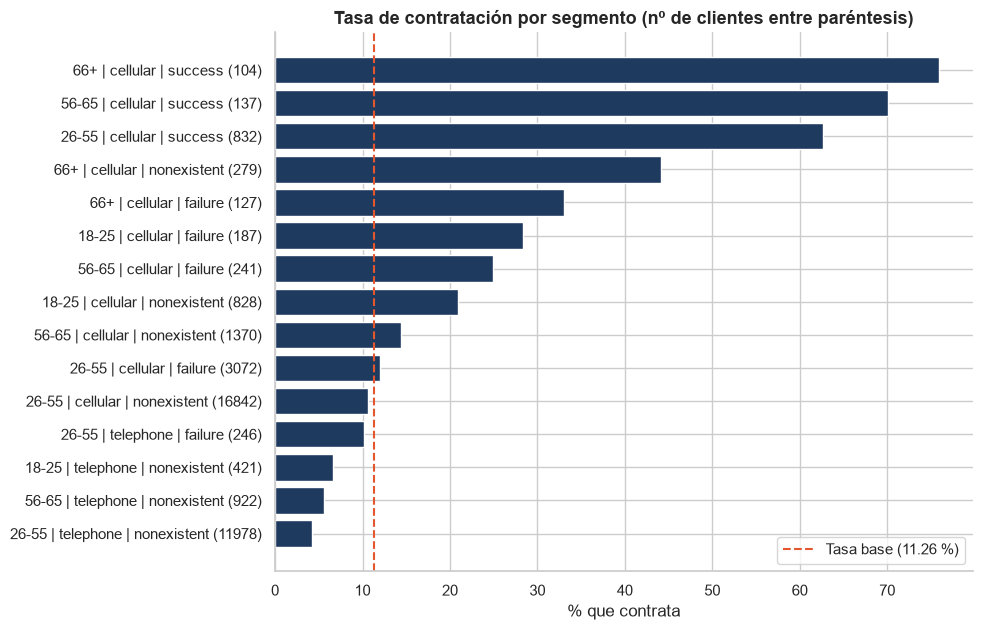
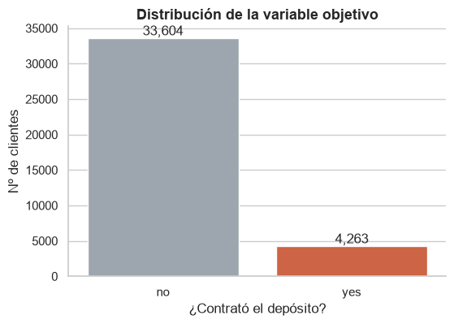
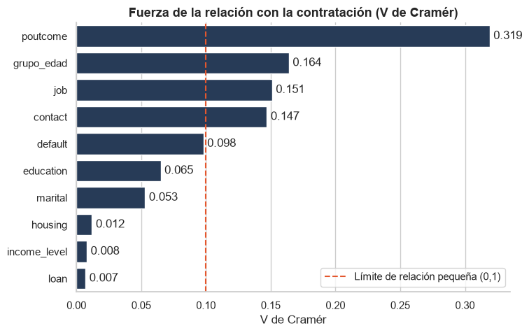
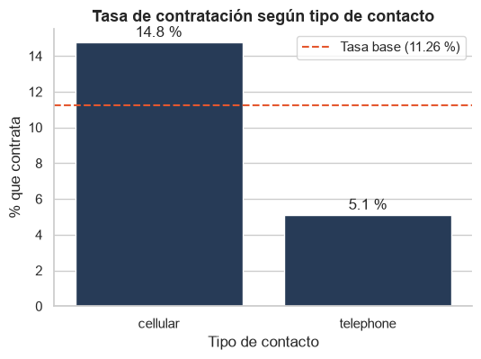
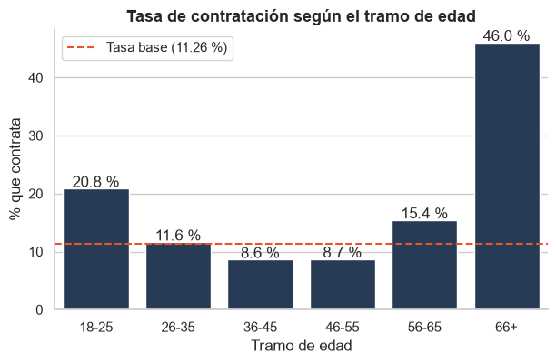
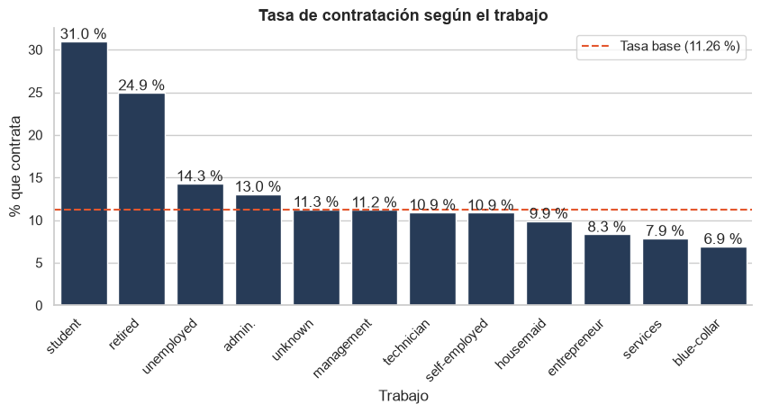
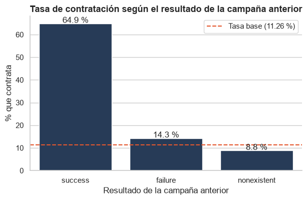
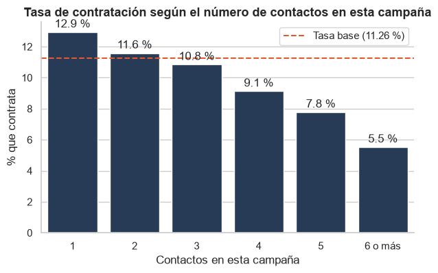
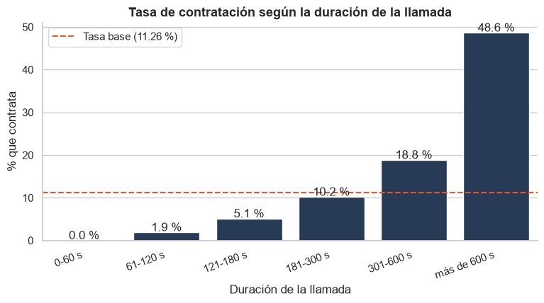

<div align="center">

# 📞 Análisis exploratorio de una campaña de depósitos a plazo

### ¿Qué clientes contratan y cómo mejorar la próxima campaña?




</div>

---

## 📌 Descripción del proyecto

Este proyecto analiza los resultados de una **campaña de marketing telefónico de un banco portugués** que ofrecía a sus clientes un **depósito a plazo**. A menudo hacía falta más de una llamada al mismo cliente para saber si contrataría o no.

El análisis está planteado desde el punto de vista del **departamento de marketing** y busca responder a una pregunta sencilla: **¿qué diferencia a los clientes que contratan de los que no?** Con la respuesta se proponen acciones concretas para la próxima campaña: a quién llamar, por qué canal y cuántas veces.

Es un análisis exploratorio y descriptivo, **sin modelos de machine learning**, hecho como proyecto del *Master in Data Analytics* de The Power Business School.

> 📄 El informe explicativo completo está en [`docs/Informe_Analisis_EDA.docx`](docs/Informe_Analisis_EDA.docx).

## 📑 Tabla de contenidos

- [Datos utilizados](#-datos-utilizados)
- [Proceso de análisis](#-proceso-de-análisis)
- [Principales hallazgos y métricas clave](#-principales-hallazgos-y-métricas-clave)
- [Visualizaciones principales](#-visualizaciones-principales)
- [Conclusiones y recomendaciones de negocio](#-conclusiones-y-recomendaciones-de-negocio)
- [Instalación y configuración del entorno](#-instalación-y-configuración-del-entorno)
- [Estructura del proyecto](#-estructura-del-proyecto)
- [Guía de uso](#-guía-de-uso)
- [Próximos pasos](#-próximos-pasos)
- [Contribución y contacto](#-contribución-y-contacto)
- [Licencia](#-licencia)
- [Agradecimientos](#-agradecimientos)

## 🗂️ Datos utilizados

**Origen:** datos de campañas de marketing directo de una institución bancaria portuguesa, facilitados por el máster en dos archivos, guardados sin modificar en `data/raw/`.

| Archivo | Contenido | Tamaño |
|---|---|---|
| `bank-additional.csv` | Resultados de la campaña telefónica, historial de campañas e indicadores económicos | 43.000 filas, 24 columnas |
| `customer-details.xlsx` | Datos demográficos de los clientes, en 3 hojas (2012, 2013 y 2014) | 43.170 filas, 7 columnas |

Tras la limpieza, el conjunto de trabajo (`data/processed/df_bc_limpio.csv`) tiene **37.867 clientes y 29 columnas**.

### Diccionario de datos resumido

| Grupo | Variables | Descripción |
|---|---|---|
| **Objetivo** | `subscribed` | Si el cliente contrata el depósito (`yes` / `no`). Antes se llamaba `y` |
| **Perfil** | `age`, `job`, `marital`, `education`, `Income`, `income_level`, `Kidhome`, `Teenhome`, `total_children` | Edad, profesión, estado civil, estudios, ingresos anuales (y su tramo) y número de hijos |
| **Situación financiera** | `default`, `housing`, `loan` | Impago previo, hipoteca y otro préstamo (`yes` / `no` / `unknown`) |
| **Contacto de esta campaña** | `contact`, `duration`, `campaign`, `date` | Canal (móvil o fijo), duración de la llamada en segundos, número de contactos y fecha |
| **Historial** | `pdays`, `previous`, `poutcome`, `previously_contacted` | Días desde el último contacto de la campaña anterior, contactos previos y resultado de la campaña anterior |
| **Indicadores económicos** | `emp.var.rate`, `cons.price.idx`, `cons.conf.idx`, `euribor3m`, `nr.employed` | Contexto macroeconómico. No se usan en el análisis de marketing |
| **Otras** | `id_`, `Dt_Customer`, `NumWebVisitsMonth` | Identificador, fecha de alta del cliente y visitas mensuales a la web |

## 🔍 Proceso de análisis

### 1. Limpieza y transformación

El código está en [`notebooks/Analisis_Premilinar_Limpieza.ipynb`](notebooks/Analisis_Premilinar_Limpieza.ipynb). Los datos tenían varias "trampas" que había que detectar:

| Qué se encontró | Qué se hizo |
|---|---|
| Datos repartidos en un CSV y un Excel con 3 hojas | Se concatenaron las hojas (43.170 clientes) y se unieron al CSV por identificador. Quedaron 43.000: 170 clientes nunca fueron llamados |
| Identificador escrito distinto (`id_` y `ID`) | Se comprobó que era el mismo dato y se usó para unir |
| Columnas sobrantes: dos `Unnamed: 0`, `ID` duplicado, `latitude` y `longitude` | Se eliminaron las 5 (de 31 a 26 columnas) |
| Cuatro indicadores económicos guardados como texto con coma decimal | Se cambió la coma por punto y se convirtieron a número |
| `date` en texto con meses en español | Se tradujeron con un diccionario y se convirtió a fecha |
| Categorías en mayúsculas (`marital`, `poutcome`) | Se pasaron a minúsculas |
| `default`, `housing` y `loan` codificadas como 1 y 0 | Se recodificaron como `yes` y `no` |
| `pdays` = 999 cuando no hubo contacto previo (el enunciado la describe como "esta campaña", pero se refiere a la anterior) | Se sustituyó 999 por nulo y se conservó la información en una variable de contacto previo |
| 5 clientes de 17 años y 8 jubilados menores de 35 años | Se eliminaron por ser incoherentes |
| Clientes sin edad (5.120) | Se descartaron al filtrar por edad. Se comprobó que no hay sesgo: contratan el 11,29 % frente al 11,26 % del resto |
| Nulos en otras variables | Mediana (`euribor3m`, `cons.price.idx`), moda por profesión (`education`) o categoría `unknown` (`default`, `housing`, `loan`, `job`, `marital`) |

Resultado: de 43.000 a **37.867 clientes**, guardados en `data/processed/df_bc_limpio.csv`. El detalle de cada decisión está en el notebook y en el informe.

### 2. Exploración

El código está en [`notebooks/EDA.ipynb`](notebooks/EDA.ipynb) y sigue este orden:

1. **Variable objetivo y tasa base** de contratación.
2. **Variables numéricas:** medias y medianas por grupo, boxplots, test t de Welch, test de Mann-Whitney y d de Cohen. Mapa de calor de correlaciones con la contratación.
3. **Variables categóricas:** tasa de contratación por categoría frente a la tasa base, test Chi-cuadrado y V de Cramér para ordenar qué variables pesan más.
4. **Comprobaciones de confusión:** cruces dentro de grupos para separar efectos (estudiantes y jubilados por edad, `default` por canal, `previous` por `poutcome`).
5. **Calendario:** año y mes de contacto.
6. **Historial y presión comercial:** `poutcome`, `previous`, `campaign` y `duration` en tramos.
7. **Segmentos:** combinación de edad, canal y resultado anterior.

### 3. Visualización

Los gráficos usan una paleta fija: **naranja** (`#E4572E`) para `yes` y la tasa base, **gris** (`#9AA5B1`) para `no` y **azul oscuro** (`#1F3A5F`) para series únicas. Las funciones que se repiten (`tabla_tasa`, `grafico_tasa`, `cohen_d`, etc.) están en [`src/soporte.py`](src/soporte.py).

## 📈 Principales hallazgos y métricas clave

**Cómo se calcula la tasa de contratación (conversión):**

```python
tasa = (df["subscribed"] == "yes").mean() * 100        # tasa base: 11,26 %
tasa_grupo = pd.crosstab(df[variable], df["subscribed"], normalize="index")["yes"] * 100
```

La **tasa base** es el % de clientes que contratan sobre el total (4.263 de 37.867 = **11,26 %**). La tasa de cada grupo se calcula igual, solo con los clientes del grupo, y se compara con la base para ver quién rinde por encima o por debajo.

| Factor | Resultado clave |
|---|---|
| **Resultado de la campaña anterior** | Éxito previo: **64,87 %** (1.261 clientes). Fracaso: 14,27 %. Sin contacto previo: 8,83 %. Es la variable más relacionada (V de Cramér = 0,32) |
| **Canal de contacto** | Móvil **14,77 %** frente a teléfono fijo **5,11 %** |
| **Edad** | 18-25 años: 20,85 %. 56-65: 15,40 %. 66 o más: 46,01 % (grupo pequeño, 576 clientes). Los tramos de 36 a 55 años, por debajo de la media |
| **Profesión** | Estudiantes 30,96 %, jubilados 24,94 %. Trabajadores *blue-collar*: 6,91 % |
| **Número de contactos** | La tasa baja de 12,93 % (1 contacto) a 5,52 % (6 o más). Con 3 contactos o menos se logra el **88,1 %** de los contratos |
| **Duración de la llamada** | Más de 5 minutos: 27,2 % de los clientes, pero 67,6 % de los contratos. Con 1 minuto o menos, 0 % de contratación |
| **Calendario** | Año y mes no distinguen: las tasas están entre 10,3 % y 12,1 % |
| **Variables sin relación** | `housing`, `loan` e `income_level` (V de Cramér por debajo de 0,02) |
| **Segmentos** | 8 segmentos con tasa del 20 % o más reúnen el 7,2 % de los clientes y el 26,9 % de los contratos |

> ⚠️ `duration` y `campaign` solo se conocen tras la llamada: sirven para entender la campaña, no para decidir a quién llamar antes.

## 🖼️ Visualizaciones principales

**1. Solo 1 de cada 9 clientes contrata.**


**2. Qué variables categóricas importan más** (V de Cramér): el resultado de la campaña anterior destaca con claridad.


**3. El móvil rinde casi 3 veces más que el teléfono fijo.**


**4. Contratan más los jóvenes y, sobre todo, los mayores.**


**5. Estudiantes y jubilados lideran; los *blue-collar* quedan al final.**


**6. El historial pesa más que cualquier otra variable.**


**7. Insistir cuesta más de lo que rinde.**


**8. Cuanto más dura la llamada, más contratan.**


## 💡 Conclusiones y recomendaciones de negocio

La contratación no se reparte al azar: depende sobre todo del **historial con el banco**, del **canal** por el que se llama y de la **edad o situación** del cliente. Año, mes, vivienda, préstamo o nivel de ingresos no ayudan a decidir a quién llamar. Para la próxima campaña:

1. **Priorizar a los clientes con éxito en campañas anteriores:** son pocos, pero contratan cerca de dos de cada tres veces.
2. **Llamar al móvil siempre que sea posible:** con el mismo tipo de cliente rinde de 2,5 a 3,1 veces más que el fijo.
3. **Dar prioridad a estudiantes, jóvenes de 18 a 25 años y mayores de 56**, que contratan por encima de la media.
4. **Limitar la insistencia:** con 3 contactos o menos ya se obtiene el 88,1 % de los contratos.
5. **Revisar el uso del teléfono fijo con clientes sin historial:** es el grupo más grande (35,2 %) y el de menor retorno (4,4 %).
6. **Usar la duración como señal de interés** durante la conversación, no como objetivo en sí misma.

**Limitaciones:** es un análisis de asociaciones, no de causas. Algunos grupos son pequeños (66 o más años). La variable `date` tiene una distribución muy regular, con picos en fechas concretas (por ejemplo, el 28 de febrero), que sugiere que no es una fecha real de contacto. La limpieza descarta el 11,9 % de los registros, sobre todo clientes sin edad.

## ⚙️ Instalación y configuración del entorno

Requisitos: **Python 3.11 o superior** y, opcionalmente, Visual Studio Code con las extensiones de Python y Jupyter.

```bash
# 1. Clonar el repositorio
git clone https://github.com/AdamTR93/MASTER_thePower_Data_Analytics.git
cd MASTER_thePower_Data_Analytics/PROYECTO_EDA_PYTHON

# 2. Crear y activar un entorno virtual
python -m venv .venv
.venv\Scripts\activate          # Windows
source .venv/bin/activate       # macOS / Linux

# 3. Instalar las librerías
pip install -r requirements.txt
```

Librerías principales: `pandas`, `numpy`, `matplotlib`, `seaborn`, `scipy`, `openpyxl` (lectura del Excel) y `jupyter`.

## 🧱 Estructura del proyecto

```
PROYECTO_EDA_PYTHON/
├── data/
│   ├── raw/                          # Datos originales, sin modificar
│   │   ├── bank-additional.csv
│   │   └── customer-details.xlsx
│   └── processed/
│       └── df_bc_limpio.csv          # Datos tras la limpieza (37.867 filas)
├── docs/
│   └── Informe_Analisis_EDA.docx   # Informe explicativo del análisis
├── images/                           # Gráficos usados en este README
├── notebooks/
│   ├── Analisis_Premilinar_Limpieza.ipynb  # Carga, unión, limpieza y guardado
│   └── EDA.ipynb                           # Análisis exploratorio
├── src/
│   └── soporte.py                    # Funciones reutilizables
├── .gitignore
├── requirements.txt
└── README.md
```

## ▶️ Guía de uso

Los notebooks usan rutas relativas (`../data/...`), así que hay que ejecutarlos **desde la carpeta `notebooks/`** (VS Code lo hace por defecto al abrirlos).

1. Abre `notebooks/Analisis_Premilinar_Limpieza.ipynb` y ejecútalo de arriba abajo (*Run All*). Lee los datos de `data/raw/` y genera `data/processed/df_bc_limpio.csv`.
2. Abre `notebooks/EDA.ipynb` y ejecútalo igual. Lee el CSV limpio y usa las funciones de `src/soporte.py`.
3. Lee el informe en `docs/Informe_Analisis_EDA.docx`.

## 🚀 Próximos pasos

- Construir un **modelo predictivo** de contratación (por ejemplo, regresión logística o árboles) usando solo variables conocidas antes de la llamada.
- Incorporar las **variables económicas** (euribor, confianza del consumidor) para ver si el contexto afecta a la contratación.
- Estudiar con más detalle los **clientes sin edad** y la variable `date`, cuya distribución parece artificial.
- Traducir los resultados a un **panel interactivo** (Power BI o Tableau) para el equipo de marketing.
- Calcular el **coste y el retorno por llamada** para priorizar segmentos.

## 🤝 Contribución y contacto

Es un proyecto académico, pero cualquier sugerencia es bienvenida: abre un *issue* o una *pull request* en este repositorio.

- 👤 **Autor:** Adam
- 🐙 **GitHub:** [AdamTR93](https://github.com/AdamTR93)
- 💼 **LinkedIn:** *(https://www.linkedin.com/in/adamtomrom/)*

## 📄 Licencia

Proyecto distribuido bajo licencia **MIT**. Consulta el archivo `LICENSE` para más información.

## 🙏 Agradecimientos

- A **The Power Business School** y a los profesores del Master in Data Analytics, por el planteamiento del proyecto y los datos.
- Al conjunto de datos de marketing directo de una institución bancaria portuguesa en el que se basa el ejercicio.
